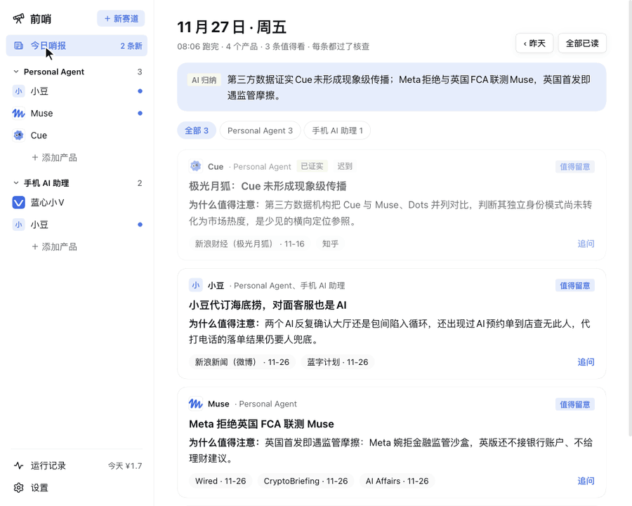
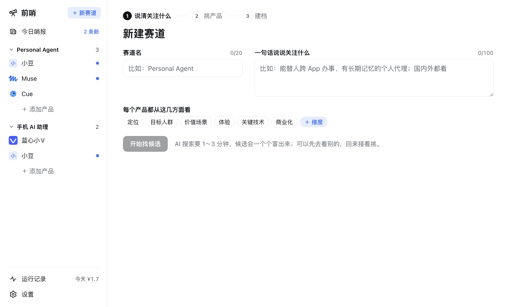
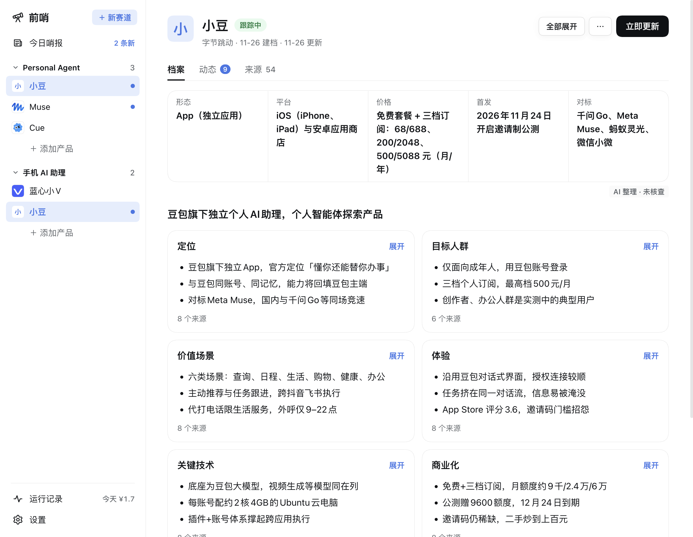
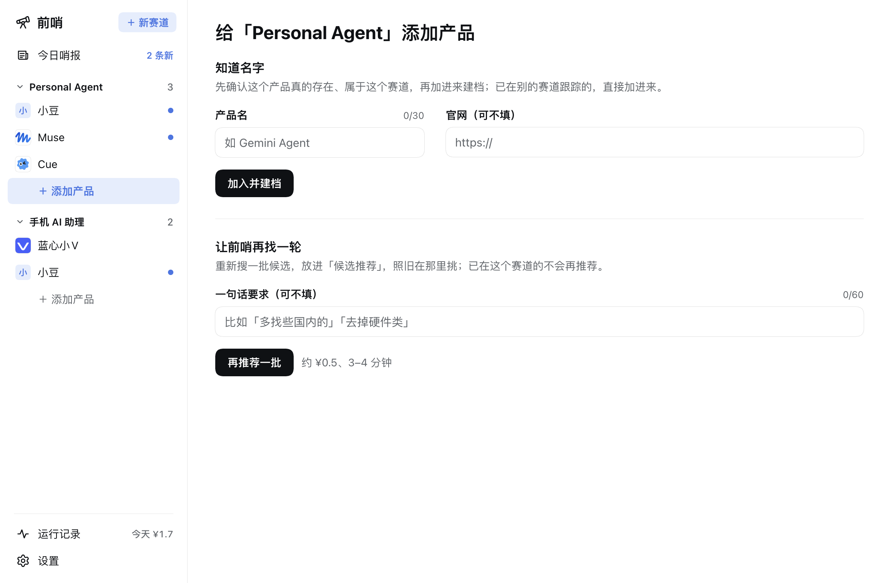

# 前哨 Outpost

[简体中文](README.md) · English

A plugin for the DeepSeek Harness desktop app that keeps watch on the products you care about.

Tell it what you're following. It recommends products and builds a sourced dossier for each one. Every morning it checks them for news, verifies the sources, and writes you a short brief, 「今日哨报」 (Today's brief).



> The interface follows the language set in DeepSeek Harness (Settings → General → Language): Chinese or English, and English for the other languages. What the AI writes (dossiers, findings, the brief's summary) is in Chinese.

## Install

Quit DeepSeek Harness (⌘Q), then run in Terminal:

```sh
curl -fsSL https://raw.githubusercontent.com/TigerdyXu/AgentOutpost/master/install.sh | sh
```

DeepSeek Harness reopens with 前哨 (Outpost) in its sidebar. Run the same line again to update; your data and settings stay.

You need:
- DeepSeek Harness desktop for macOS, 0.2.3-alpha.2 series, signed in to DeepSeek.
- Google Chrome (optional). Outpost uses it to open pages behind verification walls, such as WeChat articles and Zhihu.

## How to use

**1. Create a track.** Click **+ New track**. Name it, say in one sentence what you care about, and click **Find candidates**. Candidate products appear as the AI searches; tick the ones to follow and start tracking.



**2. Read the dossier.** Each product gets a card per dimension, such as positioning, audience, experience and business model, and every point links to its source. The **Feed** tab lists its news over time.



**3. Read the brief each morning.** Outpost runs once a day, at 08:00 by default. The most important items come first, and every one has been fact-checked. Click **Ask more** on any item to chat about it.

**4. Add products and move them between tracks.** Under a track, click **+ Add a product**. Type a product's name, or ask Outpost for another round of recommendations. Outpost also suggests newly appeared products for each track once a week, under **Suggestions** (you can turn this off on the track's page). The **⋯** menu on a product page moves the product to another track, or adds it there too.

**5. Rename or delete.** The same **⋯** menu changes a product's name, company and official site, or deletes the product. The **⋯** beside a track's name opens its settings: its name, what it follows, its dimensions, and deleting the track. Drag tracks, and the products within a track, to reorder them (or Alt+↑/↓). Deleting asks once more and can't be undone; spending records stay.

**6. Compare.** The first row under each track, **Overview**, opens the track's page. The comparison table lays every product's dimensions side by side, marks today's changes and exports to a spreadsheet. The positioning map places the products on two axes, so you can see which ones are alike and which way each is moving. The map and its one-line summary are the AI's reading of the dossiers, marked as an inference. The track page can also start a **topic**: write a question, pick some products, and the AI looks into it and writes a few conclusion cards with sources, checked like the dossiers, once or updated weekly.

**7. Search.** The box at the top of the middle column: type a product, a company, or words from a dossier, a finding or a topic, and the hits are listed by kind with the words in bold; one click opens that card or finding. Several words separated by spaces must all be there.

**8. Your own notes.** Under a product page's title, and beside "Ask more" on every finding, write a note of your own: what you think, what to watch. Only you see it and research never reads it; search, Ask more and other chats looking Outpost up use it, marked as your view.

**9. Weekly recap.** The track page's "Weekly recap": a week's (Monday to Sunday) findings worth a look, dossier changes, newly profiled products, the map's changes and topic updates, each opening the thing itself; a week that is over also gets an AI summary, written after the new week's first daily update (about ¥0.01), and that day's brief says so.

**10. Ask from any chat.** In any chat of DeepSeek Harness, ask "what does Outpost have on 小豆's business model?" or "who charges in the Personal Agent track?": the AI looks it up with `outpost_lookup` and answers from the checked dossiers and their sources, saying as of which day. It only reads and costs Outpost nothing; to keep other chats from seeing Outpost, turn it off in Outpost's Settings.



## Cost

Rough figures with DeepSeek (deepseek-flash), web searches included:
- Building one product's dossier: about ¥1–2.
- One product's daily update and fact check: about ¥0.5–1.
- Finding candidates for a new track: about ¥0.5–1.
- Drawing a track's positioning map: a few fen (once a day, when a dossier changed).
- Weekly suggestions: about ¥0.5–1 per track per week.
- A topic: about ¥1–2 each time it is looked into.

DeepSeek charges half outside weekday peak hours (9–12 and 14–18 Beijing time), and the 08:00 run is off-peak. Set a daily budget in **Settings**; once spending reaches it, the rest waits for the next day. Local models (Ollama) and a Claude subscription count as ¥0 and don't use the budget.

> These are estimates. DeepSeek Harness doesn't report what each web search actually used, so Outpost assumes about 8,000 input and 800 output tokens per search. Your DeepSeek bill is the final word.

## More

- Design: [English](docs/en/design.md) · [中文](docs/设计文档.md)
- Development and manual install (Chinese): [dev/README.md](dev/README.md)

## License

[MIT](LICENSE)
