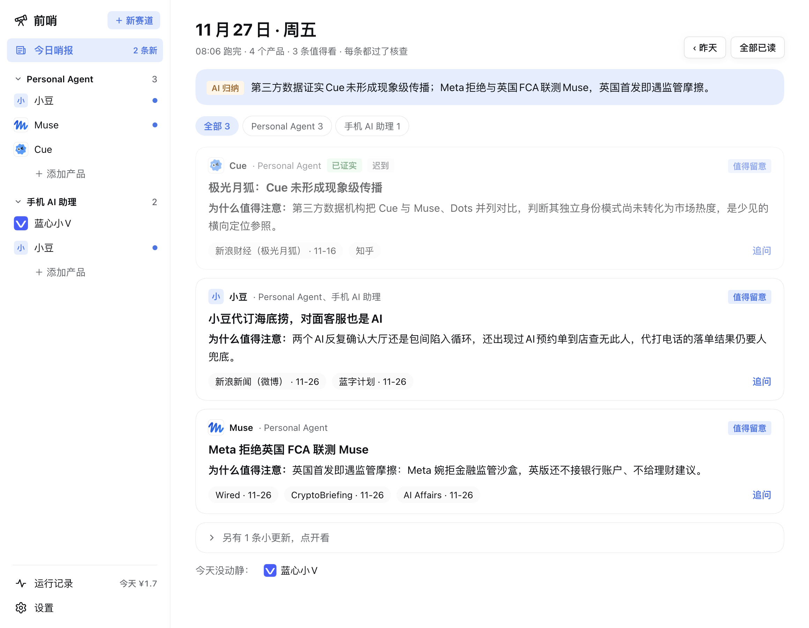
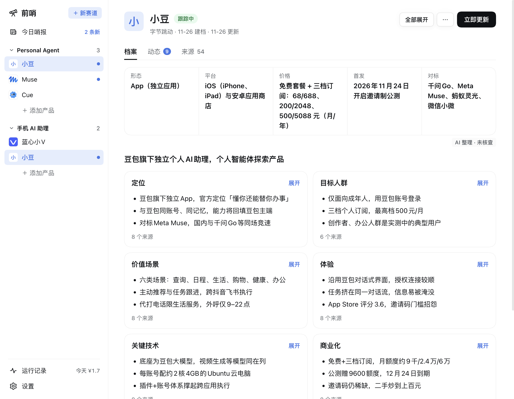

# 前哨 Outpost

English · [简体中文](README.zh-CN.md)

A plugin for the DeepSeek Harness desktop app that keeps watch on the products you care about.

Tell it what you're following. It recommends products and builds a sourced dossier for each one. Every morning it checks them for news, verifies the sources, and writes you a short brief, 「今日哨报」 (Today's brief).



> The interface is in Chinese.

## Install

Quit DeepSeek Harness (⌘Q), then run in Terminal:

```sh
curl -fsSL https://raw.githubusercontent.com/TigerdyXu/AgentOutpost/master/install.sh | sh
```

DeepSeek Harness reopens with 前哨 (Outpost) in its sidebar. Run the same line again to update; your data and settings stay.

You need:
- DeepSeek Harness desktop for macOS, 0.2.3-alpha.2 series, signed in to DeepSeek.
- Google Chrome (optional). Outpost uses it to open pages behind verification walls, such as WeChat articles and Zhihu.

## How to use

**1. Create a track.** Click 「＋ 新赛道」 (New track). Name it, say in one sentence what you care about, and click 「开始找候选」 (Find candidates). Candidate products appear as the AI searches; tick the ones to follow and start tracking.


**2. Read the dossier.** Each product gets a card per dimension, such as positioning, audience, experience and business model, and every point links to its source. The 「动态」 (Updates) tab lists its news over time.



**3. Read the brief each morning.** Outpost runs once a day, at 08:00 by default. The most important items come first, and every one has been fact-checked. Click 「追问」 (Ask) on any item to chat about it.

**4. Add products and move them between tracks.** Under a track, click 「＋ 添加产品」 (Add product). Type a product's name, or ask Outpost for another round of recommendations. The 「⋯」 menu on a product page moves the product to another track, or adds it there too.


## Cost

Rough figures with DeepSeek (deepseek-flash), web searches included:
- Building one product's dossier: about ¥1–2.
- One product's daily update and fact check: about ¥0.5–1.
- Finding candidates for a new track: about ¥0.5–1.

DeepSeek charges half outside weekday peak hours (9–12 and 14–18 Beijing time), and the 08:00 run is off-peak. Set a daily budget in 「设置」 (Settings); once spending reaches it, the rest waits for the next day. Local models (Ollama) and a Claude subscription count as ¥0 and don't use the budget.

> These are estimates. DeepSeek Harness doesn't report what each web search actually used, so Outpost assumes about 8,000 input and 800 output tokens per search. Your DeepSeek bill is the final word.

## More

- Design: [English](docs/en/design.md) · [中文](docs/设计文档.md)
- Development and manual install (Chinese): [dev/README.md](dev/README.md)

## License

[MIT](LICENSE)
