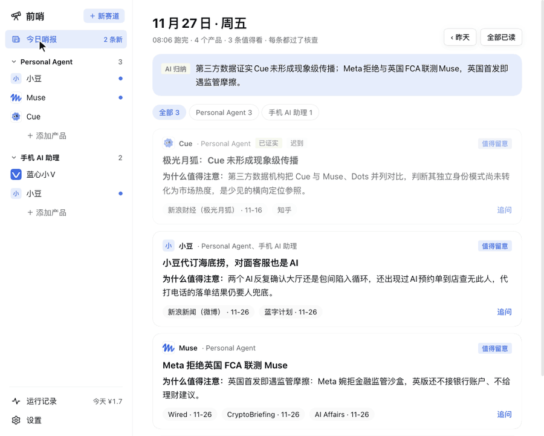
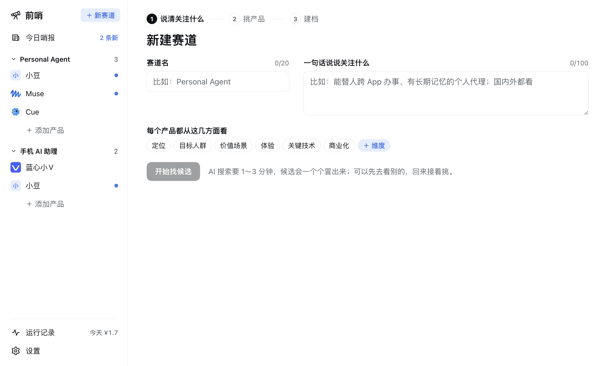

# 前哨 Outpost

简体中文 · [English](README.en.md)

DeepSeek Harness 桌面版的插件，用来每天跟踪你关心的产品。

你说清关注什么，它推荐产品、给每个产品建一份带来源的档案。之后每天早上，它把这些产品的新动态查一遍、核实来源，整理成一份「今日哨报」。



## 安装

先 ⌘Q 退出 DeepSeek Harness，再在终端运行：

```sh
curl -fsSL https://raw.githubusercontent.com/TigerdyXu/AgentOutpost/master/install.sh | sh
```

装完后桌面版会自动打开，侧栏多出「前哨」。以后再运行这一行就是更新，你的数据和设置都会保留。

**需要准备：**
- macOS 上的 DeepSeek Harness 桌面版，0.2.3-alpha.2 系列，并且已经登录 DeepSeek。
- Google Chrome，可选。前哨用它打开公众号、知乎这类需要验证的网页。

## 怎么用

**1. 建赛道。** 点「＋ 新赛道」，写赛道名和一句话关注点，再点「开始找候选」。AI 会一边搜一边列出候选产品，你勾选想跟的，然后开始跟踪。



**2. 看档案。** 每个产品按维度建卡片，比如定位、目标人群、体验、商业化，每句话都能点开看来源。「动态」页按时间列出它的新消息。


**3. 每天看哨报。** 前哨每天定时去查，默认 08:00。值得看的排在前面，每条都过了核查；对哪条有疑问，点「追问」直接聊。

**4. 加产品、换赛道。** 在赛道下点「＋ 添加产品」：知道名字就直接填；不知道就让前哨再推荐一批。前哨也会每周自动给每个赛道推荐一批新出现的产品，出现在「候选推荐」里（赛道页上可以关）。产品页右上角的「⋯」菜单里，可以把产品移到或也加到别的赛道。

**5. 改名、删除。** 同一个「⋯」菜单里能改产品的名称、公司和官网，也能删掉产品。中栏赛道名旁边的「⋯」打开赛道设置：改名称、关注点和维度，或删掉整个赛道。中栏的赛道、赛道里的产品都能拖动调整顺序（或 Alt+↑/↓）。删除前会再问一次，删了不能恢复；花费记录保留。

**6. 横向比较。** 中栏每个赛道的第一行「赛道概览」：对比矩阵把每个产品的每个维度排在一张表里，今天改过的格子标出来，能导出成表格；定位地图把产品放在两条轴上，看谁和谁是一类、谁在往哪边挪，连同一句话格局，都是 AI 读档案后的判断，标着「推论」。赛道页上还能发起「专题」：写一个问题，选几个产品，AI 去查清楚，写成几张有出处、过了核查的结论卡片，可以一次性，也可以每周更新。

**7. 搜索。** 中栏顶上的搜索框：输入产品名、公司，或者档案、动态、专题里的一句话，按种类列出找到的地方，词加粗标出，点开直接到那张卡或那条动态。几个词用空格隔开，都出现才算。

**8. 自己的笔记。** 产品页标题下面、每条发现的「追问」旁边，都能写一段自己的笔记：看法、要盯的事。笔记只有你看得到，调研不会读它；搜索、追问和其他对话查前哨时会用上，并标明是你的看法。

**9. 在别的对话里问。** 在 DeepSeek Harness 里随便开一个对话，问「前哨里小豆的商业化怎么样」「Personal Agent 赛道里谁在收费」，AI 会用 `outpost_lookup` 查前哨的资料，按核查过的档案和出处回答，并说明截至哪天。只读，不花前哨的钱；不想让其他对话看到，在前哨的「设置」里关掉。

界面语言跟着 DeepSeek Harness 的设置走（设置 → 通用 → 语言）：中文或英文，其他语言显示英文。AI 写的档案、发现和哨报总结是中文。


## 花费

用 DeepSeek（deepseek-flash）时的大致花费，已算上联网搜索：
- 给一个产品建档：约 ¥1–2；
- 每个产品每天的日更加核查：约 ¥0.5–1；
- 新建赛道时找一批候选：约 ¥0.5–1；
- 画一次赛道的定位地图：几分钱（档案有变化时每天一次）；
- 每周推荐新产品：每个赛道每周约 ¥0.5–1；
- 专题：每深挖一次约 ¥1–2。

DeepSeek 在工作日高峰（北京时间 9–12 点、14–18 点）以外半价，08:00 的日更正好在闲时。在「设置」里可以设每日预算，花到上限后当天就停。如果模型选本机的 Ollama 或 Claude 订阅，前哨按 ¥0 记，也不占预算。

> 这些都是估算。DeepSeek Harness 不报告每次联网搜索实际用了多少，前哨按每次约 8000 输入、800 输出 token 估算。实际花了多少，以 DeepSeek 的账单为准。

## 更多

- 设计：[中文](docs/设计文档.md) · [English](docs/en/design.md)
- 开发、手动安装和退回旧版本：[dev/README.md](dev/README.md)

## 许可

[MIT](LICENSE)
